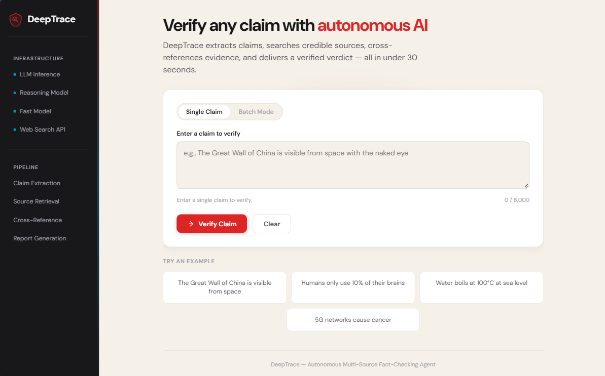
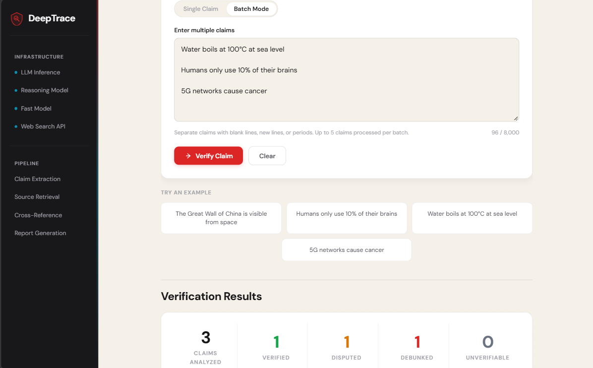

<div align="center">


# DeepTrace

### Autonomous Multi-Source Fact-Checking Agent

<p>
  <em>Verify any claim against live web evidence in under 30 seconds.</em>
</p>

<p>
  
  
  
  
</p>

<p>
  
  
  
  
</p>

<br/>

**Built for the Nebius × NVIDIA Global AI Hackathon 2026 — Track 2: Best Apps & Agents**

<p>
  <a href="https://umaima-manzoor--deeptrace-web.us-east.modal.run"><b>🌐 Live Demo</b></a> &nbsp;·&nbsp;
  <a href="#"><b>🎬 Video Walkthrough</b></a> &nbsp;·&nbsp;
  <a href="#-architecture"><b>⚙️ Architecture</b></a> &nbsp;·&nbsp;
  <a href="#-quick-start"><b>⚡ Quick Start</b></a>
</p>

</div>

---

<div align="center">

### ⚠️ The Problem

</div>

In 2026, AI-generated synthetic content and out-of-context claims spread across the web in **seconds**. Human fact-checkers take **hours**. By the time a correction lands, the false narrative has already anchored in millions of minds.

<div align="center">

### 🎯 The Solution

</div>

**DeepTrace** is an autonomous verification agent that closes the real-time information gap. Paste any claim or article excerpt, and watch a four-stage pipeline extract atomic propositions, search tier-ranked authoritative sources via Tavily, cross-reference evidence with NVIDIA Nemotron 3 Super, and deliver a verdict with full source attribution — all in under 30 seconds.

---

<div align="center">

## ⚙️ Architecture

```mermaid
flowchart LR
    A([User Input<br/>Claim or Article]) --> B[Stage 1<br/>Claim Decomposition]
    B -->|Nemotron 3 Nano| C([Atomic Claims])
    C --> D[Stage 2<br/>Live Web Retrieval]
    D -->|Tavily Search| E([Tier-Ranked Sources])
    E --> F[Stage 3<br/>Cross-Reference & Stance]
    F -->|Nemotron 3 Super| G([Evidence Synthesis])
    G --> H([Stage 4<br/>Verdict Scorecard])

    style A fill:#f5f0e8,stroke:#18181b,color:#18181b
    style H fill:#dc2626,stroke:#b91c1c,color:#ffffff
    style B fill:#ffffff,stroke:#0891b2,color:#18181b
    style D fill:#ffffff,stroke:#0891b2,color:#18181b
    style F fill:#ffffff,stroke:#0891b2,color:#18181b
    style C fill:#ecfeff,stroke:#0891b2,color:#18181b
    style E fill:#ecfeff,stroke:#0891b2,color:#18181b
    style G fill:#ecfeff,stroke:#0891b2,color:#18181b
```

</div>



---

<div align="center">

## ✨ Features

</div>

<table>
<tr>
<td width="50%" valign="top">

#### 🧠 Atomic Claim Decomposition
Extracts verifiable factual assertions from complex text using **NVIDIA Nemotron 3 Nano** for precision-targeted searches.

#### 🌐 Authoritative Live Retrieval
Pulls **8 independent, live web sources** per claim via Tavily, filtered and ranked by domain authority.

#### ⚖️ Stance & Contradiction Detection
**NVIDIA Nemotron 3 Super** evaluates supporting vs. contradicting evidence with nuanced multi-angle reasoning.

#### 🏷️ Misinformation Taxonomy
Classifies debunked claims by deceit type — Cherry-Picking, Exaggeration, False Context, Fabrication, Persistent Myth — with hover-to-explain tooltips.

</td>
<td width="50%" valign="top">

#### 📊 Explainable Scorecard
Color-coded verdicts with transparent confidence scores:
- 🟢 **Verified** · high-trust consensus
- 🟡 **Disputed** · mixed evidence
- 🔴 **Debunked** · contradicted by sources
- ⚪ **Unverifiable** · insufficient evidence

#### 📦 Batch Mode
Process up to **5 claims simultaneously** with a consolidated summary dashboard.

#### 🚀 Serverless Deployment
Hosted on **Modal** with scale-to-zero infrastructure and sub-10s cold starts.

#### 🎨 Warm Authority Design
Custom palette, DM Sans typography, animated loading stages, and tier-ranked source cards.

</td>
</tr>
</table>

---

<div align="center">

## 🖼️ Interface

</div>

> _Screenshots coming soon — add to `docs/screenshots/` and reference below._

<div align="center">

<!-- Replace with actual screenshots after capturing -->


<br/><br/>


<br/><br/>



</div>

---

<div align="center">

## 🛠️ Stack

</div>

| Layer | Technology | Role |
|:---|:---|:---|
| 🧠 **Deep Reasoning** | NVIDIA Nemotron 3 Super (120B) | Cross-referencing, nuance detection, verdict synthesis |
| ⚡ **Fast Preprocessing** | NVIDIA Nemotron 3 Nano (30B) | Claim extraction, lightweight query parsing |
| ☁️ **Inference Platform** | Nebius Token Factory | Hosted endpoints for Nemotron models |
| 🔍 **Search Engine** | Tavily AI | Agentic web search optimized for LLM grounding |
| 🔧 **Backend** | FastAPI + Python 3.11 | Async 4-stage verification pipeline |
| ⚛️ **Frontend** | HTMX + Jinja2 | Reactive server-rendered UI, zero JS framework overhead |
| 🎨 **Styling** | Vanilla CSS + DM Sans | Warm authority palette, custom animations |
| 🚢 **Deployment** | Modal | Serverless hosting with scale-to-zero |

---

<div align="center">

## ⚡ Quick Start

</div>

### 1. Clone the repository

```bash
git clone https://github.com/Umaima-Manzoor/DeepTrace.git
cd DeepTrace
```

### 2. Create and activate a virtual environment

```bash
python -m venv venv
```

**Windows (PowerShell)**
```powershell
.\venv\Scripts\Activate.ps1
```

**Windows (Command Prompt)**
```bat
.\venv\Scripts\activate.bat
```

**macOS / Linux**
```bash
source venv/bin/activate
```

### 3. Install dependencies

```bash
pip install -r requirements.txt
```

### 4. Configure environment variables

```bash
cp .env.example .env
```

Open `.env` and add your API keys:

```env
LLM_API_KEY=your_nebius_api_key_here
LLM_BASE_URL=https://api.tokenfactory.nebius.com/v1
FAST_MODEL=nvidia/NVIDIA-Nemotron-3-Nano-30B-A3B
REASONING_MODEL=nvidia/nemotron-3-super-120b-a12b
SEARCH_API_KEY=your_tavily_api_key_here
APP_ENV=development
MAX_SEARCH_RESULTS=8
CONFIDENCE_THRESHOLD=0.75
```

### 5. Launch the server

```bash
uvicorn main:app --reload
```

Open **[http://127.0.0.1:8000](http://127.0.0.1:8000)** in your browser.

---

<div align="center">

## 🚢 Deployment

</div>

### Modal (recommended — serverless, scale-to-zero)

```bash
pip install modal
modal setup
```

Create your secrets:

```bash
modal secret create deeptrace-secrets \
  LLM_API_KEY=your_nebius_key \
  LLM_BASE_URL=https://api.tokenfactory.nebius.com/v1 \
  FAST_MODEL=nvidia/NVIDIA-Nemotron-3-Nano-30B-A3B \
  REASONING_MODEL=nvidia/nemotron-3-super-120b-a12b \
  SEARCH_API_KEY=your_tavily_key \
  APP_ENV=production
```

Deploy:

```bash
modal deploy modal_app.py
```

Your app goes live at `https://<username>--deeptrace-web.us-east.modal.run`.

---

<div align="center">

## 🏆 Hackathon Alignment

</div>

<table>
<tr>
<td width="25%" align="center"><b>Technology</b></td>
<td>Dual-model agentic architecture (Nemotron 3 Super + Nano) on Nebius Token Factory, orchestrated through a deterministic 4-stage pipeline.</td>
</tr>
<tr>
<td align="center"><b>Design</b></td>
<td>Reactive FastAPI + HTMX interface with real-time stage animations, tier-ranked source cards, hover-explained classifications, and a warm authority palette.</td>
</tr>
<tr>
<td align="center"><b>Impact</b></td>
<td>Direct countermeasure against viral AI hallucinations — paste a claim, get a verdict in under 30 seconds. Zero user friction.</td>
</tr>
<tr>
<td align="center"><b>Tavily Integration</b></td>
<td>Deeply integrated for grounded multi-angle research loops, pulling 8 live web sources per claim with domain tier filtering.</td>
</tr>
</table>

---

<div align="center">

## 📄 License

Released under the [MIT License](LICENSE).

<br/>

<sub>Designed and engineered by <b>Umaima Manzoor</b></sub>

<sub>Nebius × NVIDIA Global AI Hackathon 2026</sub>

</div>